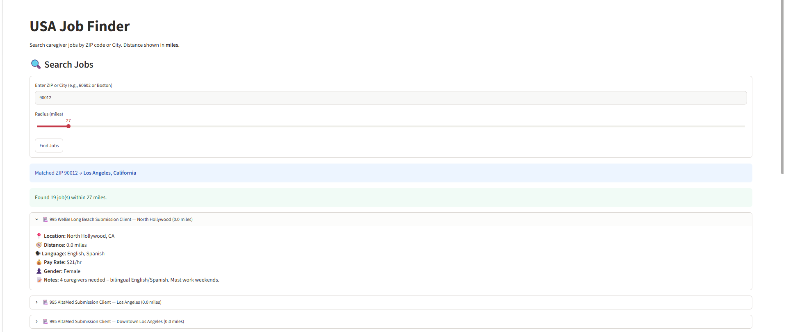
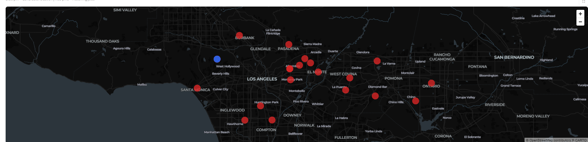
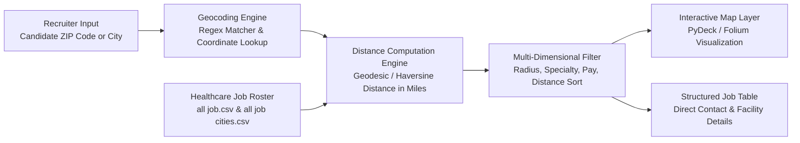

# 📍 Healthcare Job Finder & Geospatial Matching Platform

[](https://all-jobs.streamlit.app)
[](https://github.com/Ujwal-Bamb/all-jobs-finder.git)


> **Location-Aware Healthcare Recruiter Platform** that matches caregiver and healthcare professionals to facility job opportunities using Haversine/geodesic distance calculations, fuzzy location resolution, and interactive 3D map clustering.

---

## 🔗 Live Application & Repository

- **Live Application**: [https://all-jobs.streamlit.app](https://all-jobs.streamlit.app)
- **Source Code**: [https://github.com/Ujwal-Bamb/all-jobs-finder.git](https://github.com/Ujwal-Bamb/all-jobs-finder.git)

---

> [!IMPORTANT]
> **Primary Streamlit Entry Point Notice**:  
> Although multiple `.py` files exist in this repository (e.g., `app (3).py` exploring experimental agentic extensions), **`app.py` is the primary Streamlit entry point**. To launch the application locally, run:
> ```bash
> streamlit run app.py
> ```

---

## 📸 Screenshots

> *Add your application screenshots to `docs/screenshots/` using the exact paths below to render them automatically:*

| Candidate Proximity Search UI | Interactive Radius Map Visualization |
| :---: | :---: |
|  |  |
| *Candidate ZIP code input, search radius slider, and job table* | *Dynamic distance radius circle with clustered facility markers* |

---

## 🎯 Problem Statement & Recruiter Bottlenecks

In healthcare and caregiver staffing operations, recruiters spend hours manually cross-referencing candidate rosters against fragmented spreadsheets containing client facility requisitions.

Traditional spreadsheet filtering introduces major operational friction:
1. **City-Border Blindspots**: A candidate living 5 miles away in an adjacent town is excluded if the recruiter filters strictly by facility city text.
2. **Multi-Sheet Lookups**: Matching specialty, pay rates, shifts, and mileage across multiple facilities requires slow, error-prone manual lookups.
3. **Delayed Outreach**: Time lost to manual sorting reduces candidate placement velocity.

---

## 💡 Solution Architecture & Technical Implementation

This application replaces manual multi-sheet lookups with an automated, location-aware matching interface:



### Key Technical Capabilities:
- **Primary Application Entry Point**: `app.py` serves as the primary, tested Streamlit runner for the production application.
- **Geodesic Distance Engine**: Computes exact ellipsoidal real-world mileage (`geopy.distance.geodesic`) between candidate origin coordinates and target healthcare facilities.
- **Coordinate Resolution & Fallbacks**: Utilizes regex pattern matching (`\b(\d{5})(?:-\d{4})?\b`) to parse 5-digit US ZIP codes and resolves city coordinates dynamically using `all job cities.csv` to bypass third-party API rate limits.
- **Interactive Geospatial Visualization**: Renders interactive map views displaying the candidate epicenter, customizable radius boundary rings (e.g., 10 to 50+ miles), and facility pins.
- **Recruiter Filters**: Filter opportunities by max radius, job title, client facility, and hourly/weekly pay rates.

---

## 📁 Repository Structure

```
all-jobs-finder/
├── .devcontainer/
│   └── devcontainer.json           # VS Code development container configuration
├── .streamlit/
│   └── config.toml                 # Streamlit UI theme and server settings
├── docs/
│   └── screenshots/                # Application screenshot placeholders
│       ├── job_finder_ui.png
│       └── geospatial_radius_map.png
├── all job.csv                     # Healthcare facility jobs and client dataset
├── all job cities.csv              # Reference latitude/longitude coordinates table
├── app.py                          # PRIMARY production Streamlit application runner
├── app (3).py                      # Experimental copilot script (secondary)
├── requirements.txt                # Python dependencies
├── LICENSE                         # Project license
└── README.md                       # Comprehensive documentation
```

---

## 🚀 Local Installation & Setup

### 1. Clone the Repository
```bash
git clone https://github.com/Ujwal-Bamb/all-jobs-finder.git
cd all-jobs-finder
```

### 2. Set Up Virtual Environment & Dependencies
```bash
# Create virtual environment
python -m venv venv

# Activate environment
# Windows:
.\venv\Scripts\activate
# Linux/macOS:
source venv/bin/activate

# Install dependencies
pip install -r requirements.txt
```

### 3. Launch Streamlit Application
```bash
streamlit run app.py
```
Open your browser at `http://localhost:8501` to use the application.

---

## 🛠️ Usage Workflow

1. **Enter Candidate Origin**: Input a 5-digit US ZIP code (e.g., `90210`) or City Name in the search bar.
2. **Adjust Radius**: Select your target radius threshold using the slider (e.g., 25 miles).
3. **Inspect Proximity Results**: View the ranked results table sorted by ascending mileage distance from the candidate.
4. **Interactive Map Exploration**: Click map pins to review client facility names, pay rates, and job titles.

---

## 👤 Author & Contact

**Ujwal Bamb**  
- **Email**: [ujwalbamb2000@gmail.com](mailto:ujwalbamb2000@gmail.com)  
- **LinkedIn**: [linkedin.com/in/ujwal-bamb-276b04330](https://www.linkedin.com/in/ujwal-bamb-276b04330)  
- **GitHub**: [@Ujwal-Bamb](https://github.com/Ujwal-Bamb)  
- **Credentials**: MeitY-NASSCOM Gold Certified (96/100, NSQF Level 5, ID: FSP/2026/11/10520719) | Master of Computer Science in AI & ML, Woolf University (Jan 2025 - Present) | B.Pharm (SPPU)
